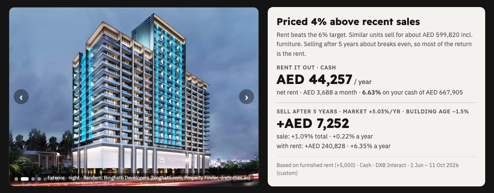
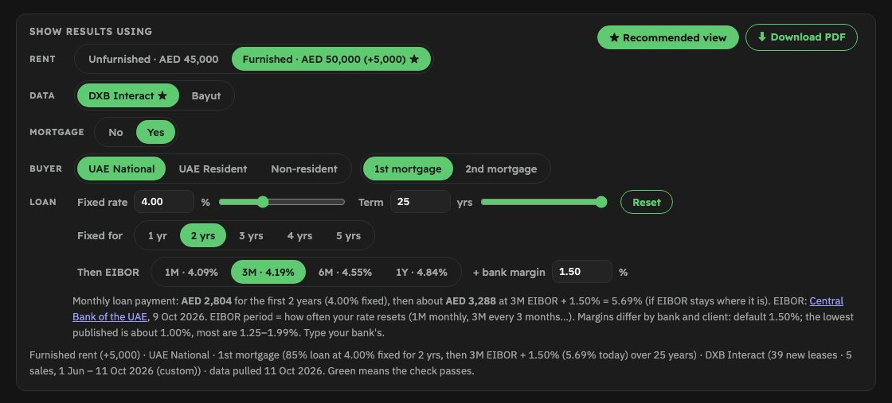
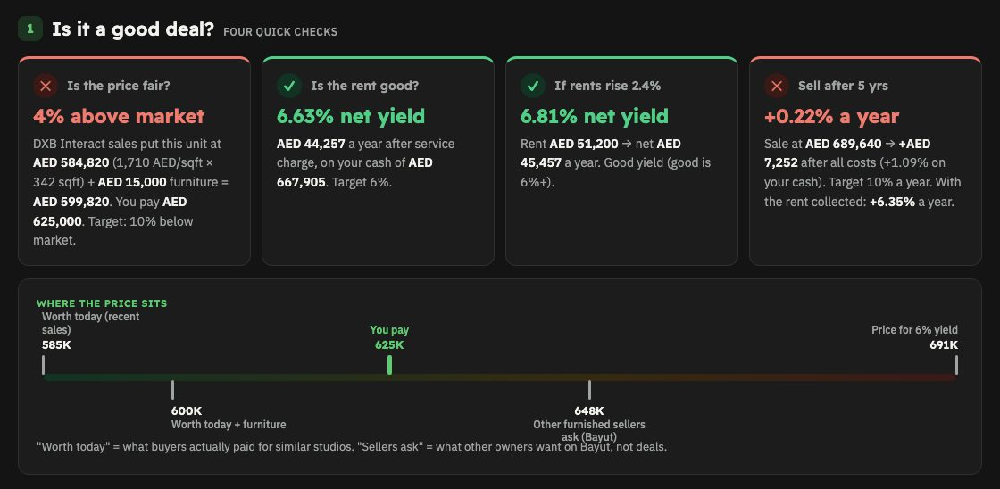
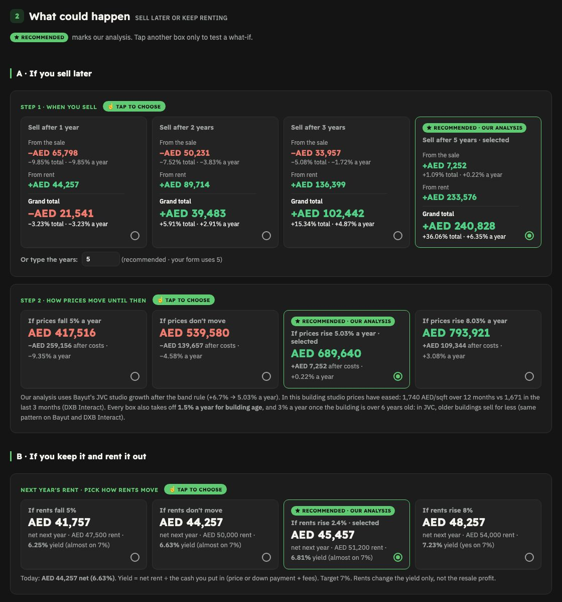
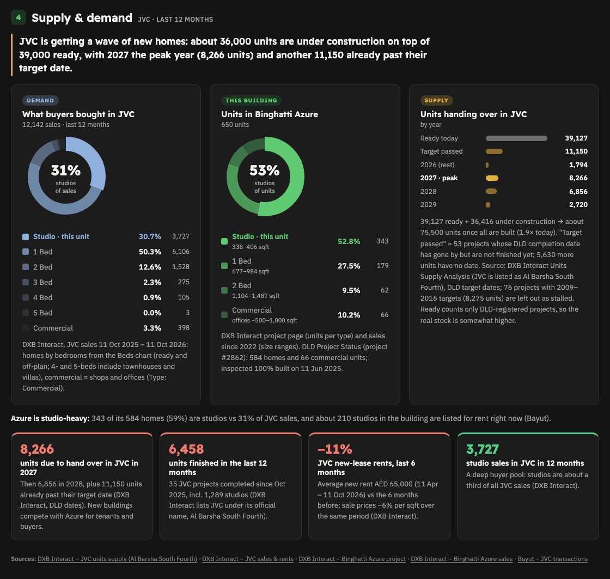
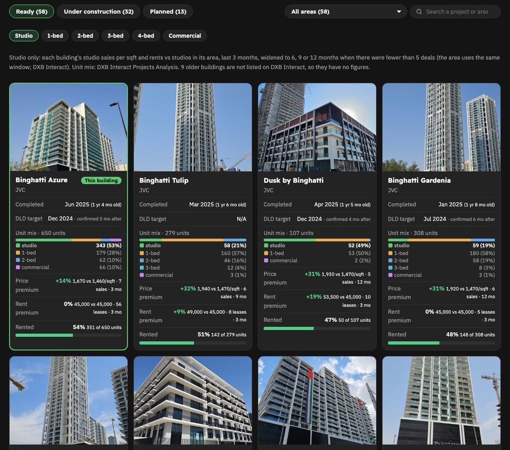

# Ready Property Report

[](CHANGELOG.md)

Part of **[The Ultimate Real Estate Calculator](../../README.md)**.

**Version 1.1.0** · [Changelog](CHANGELOG.md) · Version history: [all versions](https://github.com/AbdullaAlzarooni/ultimate-real-estate-calculator/tags) · [collection releases](https://github.com/AbdullaAlzarooni/ultimate-real-estate-calculator/releases) · by **Abdulla Alzarooni** (Real Estate with Abdulla Alzarooni)

For **ready (completed) units on the resale market**, bought with **cash or a mortgage**. Give Claude a
Bayut or Property Finder listing and it builds a client-ready report (web page + PDF) that answers:
**is the price fair compared with what similar units in the building actually sold for, what does it rent
for, what do I earn on my cash, what will the mortgage cost me, and what could I sell it for later?**


**Also built in (v1.1):** a **distressed deal test** for resales (7% rental ROI + 10% below similar sales),
**similar listings now** with possible distressed deals, and **Your mortgage, year by year** (yearly and monthly
cashflow, EIBOR scenarios, a positive-cashflow test) (`references/modules.md`).

---

## See it
Example: Binghatti Azure furnished studio, JVC, listed at AED 625,000.

**Verdict:** priced above or below recent sales, net rent and yield on your cash, sale after 5 years



**Cash or mortgage:** buyer type, 1st or 2nd mortgage, fixed rate then EIBOR + bank margin, monthly payment



**Four deal checks and where the price sits**



**What could happen:** sell after 1–10 years (market growth and building age), or keep it and rent it out



**Supply & demand:** what buyers in the area bought, the building's unit mix, units handing over per year



**The developer (optional):** every project by the developer, ready / under construction / planned, with
photos, delivery record, unit mix, rented % and price / rent premium per unit type



---

## What you get
- **Is the price fair?** The unit's price vs a **size-matched** median of recent sales in the same building
  (DXB Interact, ±10% of the unit's size), plus the value of the furniture if it's furnished
- **Rent and yield:** unfurnished and furnished rent (measured furnished premium), service charge from DLD,
  net rent and **net yield on the cash you put in** (Good ≥ 6% · OK 5–6% · Low < 5%, same as the Off-plan Report), and the price that would reach 6%
- **Cash or mortgage:** UAE National / UAE Resident / Non-resident, 1st or 2nd mortgage (Central Bank loan
  limits), fixed rate for 1–5 years then **EIBOR (1M / 3M / 6M / 1Y, that day's Central Bank fixing) + bank
  margin**, monthly payment before and after the fixed period, life and property insurance, bank and mortgage
  registration fees, early settlement fee (1%, max AED 10,000) and release fee when you sell
- **Sell after 1–10 years:** market growth (Bayut 12-month change after the growth bands), slower growth after
  year 5, and a **building-age discount** measured from the area's sales by building age
- **From the sale / from rent / grand total** on every hold period, with the loan still owed at the sale
- **Supply & demand** (DXB Interact): units ready and under construction in the area, handovers per year,
  what buyers bought by unit type, this building's unit mix
- **Developer section (optional):** Claude asks first; it takes a long time to build
- **Market evidence** per source with the actual deals listed, view map, location comfort cards (sun, shade,
  road and aircraft noise, flooding…), step-by-step calculations, photo gallery, contact footer, client PDF

---

## Quick start
Install once (see the [install guide](../../README.md#install-guide-step-by-step)); one install gives you every
calculator. Then, in the Claude desktop app's **Code** tab, paste a listing link and say:
> Make a ready property report for this unit: https://www.bayut.com/property/details-…

The first time, Claude asks for your details and which data accounts you have; they are saved.
If you already use the Off-plan Report, it reuses your details.

---

## Websites it uses
| Website | Used for | Account |
|---|---|---|
| Listing (Bayut / Property Finder) | price, size, balcony, furnished, floor | public |
| [DXB Interact](https://dxbinteract.com) | size-matched sales and new-lease rents in the building, area trends, sales by building age, supply, what's selling, unit mix, rented % | free tier |
| [Bayut market analysis](https://www.bayut.com/property-market-analysis/) | second source for sales and rents, 12-month growth, furnished vs unfurnished | public |
| [DLD](https://dubailand.gov.ae) | Service Charge Index, Project Status (completion date, inspections, units) | public |
| [Central Bank of the UAE](https://centralbank.ae/en/forex-eibor/eibor-rates/) | that day's EIBOR rates | public |
| Google Maps (satellite, Street View) | facing, distances, what is next to the building | public |
| [GIS DDA](https://gis.dda.gov.ae/DIS/) | neighbouring plots' allowed heights (DDA areas only) | public |
| [SunCalc](https://www.suncalc.org) · [ShadeMap](https://shademap.app) | sun and shade | public |
| [Noise-map](https://noise-map.com) · [Windy](https://www.windy.com) | aircraft noise · wind & sea | public |
| Developer site / agency project pages | building photos (no watermarks) | public |

**Property Monitor is never used:** it does not allow AI use.
**Minimum for a report:** the listing + Bayut. DXB Interact makes it much stronger (size-matched deals).
Full details per site: [references/sources.md](references/sources.md).

---

## How it works (for the curious)
- `SKILL.md` — the instructions Claude follows
- `references/` — step-by-step workflow, websites, formulas (fees, loan limits, growth, building age),
  design decisions, every data field, the developer section
- `kit/` — `build.py`, `template/report-template.html` (layout + all formulas),
  `data/example-binghatti-azure-studio.js` (a complete real example with its photos), `tools/` (view-map tools)

Try the example yourself:
```bash
cd ~/.claude/ultimate-real-estate-calculator/skills/ready-report/kit
python3 build.py data/example-binghatti-azure-studio.js
python3 -m http.server 8000      # then open http://localhost:8000/example-binghatti-azure-studio.html
```
The formulas follow the author's Ready Property Evaluation Form (Google Sheet); the example was checked
against it row by row.

---

## License & credit
© 2026 Abdulla Alzarooni (Real Estate with Abdulla Alzarooni). All rights reserved.

**Free to use** for your own client reports. **Keep the "The Ultimate Real Estate Calculator ©" credit line** on every
report and the notices in the code. **No resale** or passing it off as your own.
Full terms: [LICENSE](../../LICENSE). Commercial use or removing the credit:
contact [@abdulla.al.zarooni](https://www.instagram.com/abdulla.al.zarooni) on Instagram.

## Disclaimer
Reports are estimates based on market data and the listing — **not financial advice**. Mortgage figures are
estimates; confirm rates, fees and limits with your bank. Check each data site's terms of use.
Icons: Font Awesome Free brand shapes (CC BY 4.0).

## Feedback
Found a problem? [Open an issue](https://github.com/AbdullaAlzarooni/ultimate-real-estate-calculator/issues/new) or message [@abdulla.al.zarooni](https://www.instagram.com/abdulla.al.zarooni) on Instagram.
